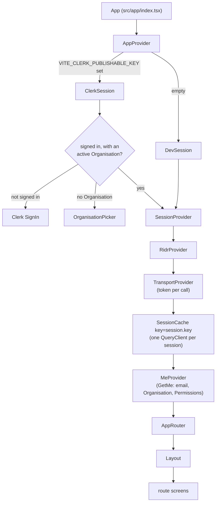
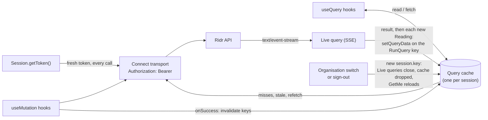
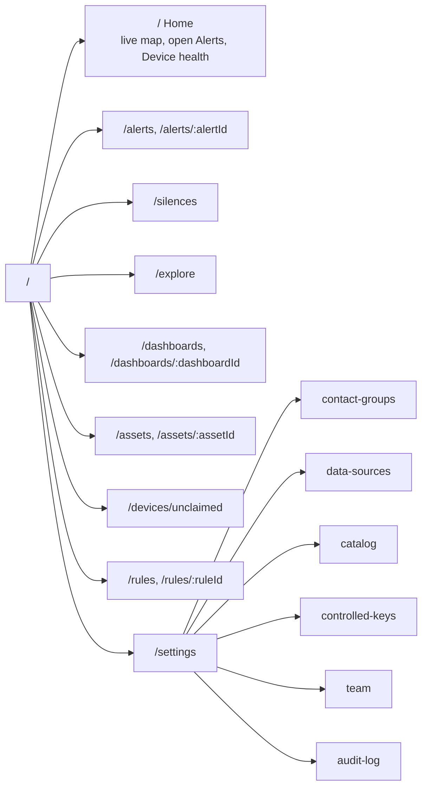

# Building the Ridr web app: start here

These pages tell a React developer, and their coding agent, how to build
the web app that Operations managers use on top of Ridr. Each page is a
short guide followed by a precise **contract**: the behaviour the app
must have. They specify behaviour and states only; the UI kit, forms and
visual design are yours.

Words with a capital letter (Reading, Asset, Rule, Alert, Scope,
Organisation...) are the product's words, defined once in the
[glossary](../../CONTEXT.md). Use them in UI labels, code and
conversations alike.

Code samples come from the starter app in [`web/starter`](../../web/starter),
which CI builds and tests. Each sample names its file; a test
(`test/docs`) fails when a sample stops matching the file it quotes.

## What Ridr is

Ridr is a telemetry platform, "Datadog for IoT". Tenants send what
their Devices report through Adapters; Ridr turns it into
Readings (Measurements, Locations and Events) that the app queries,
watches live, and raises Alerts on through Rules. A Tenant is shown to
users as their **Organisation**.

The app talks to one backend over two channels:

- **Connect RPC** for every procedure (`AlertService/ListAlerts`,
  `RuleService/CreateRule`...), through the generated client package
  `@ridr/web` (in [`sdk/web`](../../sdk/web)).
- **Server-Sent Events** at `GET /v1/live-query` for Live queries.

## The stack

| Concern | Choice |
|---|---|
| Build | Vite + TypeScript |
| Routing | React Router |
| Sign-in | Clerk's React SDK (`@clerk/react`); a dev token locally |
| Server state | TanStack Query through connect-query |
| API client | `@ridr/web` (generated from the protos) |
| Live data | `fetch` plus `eventsource-parser` |
| Folders | Bulletproof React's feature folders |

## Pages

| Page | Read it when |
|---|---|
| [Getting started](getting-started.md) | setting up a machine: backend, demo data, starter, Clerk |
| [Providers](architecture/providers.md) | wiring the root of the app |
| [Data flow](architecture/data-flow.md) | writing any query or mutation hook |
| [Sign-in and sessions](architecture/sessions.md) | handling sign-in, sign-out or Organisation switches |
| [Permissions](architecture/permissions.md) | showing, hiding or gating any action or route |
| [Live data](architecture/live-data.md) | anything that updates without a reload |
| [Errors](architecture/errors.md) | showing any failed call |
| [Project structure](architecture/project-structure.md) | adding a file or a feature |
| [Permissions table](reference/permissions.md) | checking which Role may call a procedure (generated) |
| [Query language](reference/query-language.md) | writing or showing a Query; times, units and cost limits in answers |
| [Limitations](reference/limitations.md) | before designing any screen: what isn't built and the workarounds |
| [Glossary](../../CONTEXT.md) | naming anything: UI labels, code and docs use its words |

One page per route group, each with the same headings: routes, data,
mutations, live updates, permissions, states, done when.

| Feature page | Route |
|---|---|
| [Home](features/home.md) | `/` |
| [Alerts](features/alerts.md) | `/alerts`, `/alerts/:alertId` |
| [Silences](features/silences.md) | `/silences` |
| [Explore](features/explore.md) | `/explore` |
| [Dashboards](features/dashboards.md) | `/dashboards`, `/dashboards/:dashboardId` |
| [Assets and Unclaimed devices](features/assets.md) | `/assets`, `/assets/:assetId`, `/devices/unclaimed` |
| [Rules](features/rules.md) | `/rules`, `/rules/:ruleId` |
| [Contact groups](features/contact-groups.md) | `/settings/contact-groups` |
| [Data sources](features/data-sources.md) | `/settings/data-sources` |
| [Catalog](features/catalog.md) | `/settings/catalog` |
| [Controlled keys](features/controlled-keys.md) | `/settings/controlled-keys` |
| [Team](features/team.md) | `/settings/team` |
| [Audit log](features/audit-log.md) | `/settings/audit-log` |

## Provider tree

Everything below the session gate belongs to one signed-in user acting
in one Organisation. When either changes, the subtree from
`SessionCache` down is thrown away and rebuilt (see
[Providers](architecture/providers.md)).

## Data flow

Live queries carry Readings only: Alert lists poll (see
[Data flow](architecture/data-flow.md)).

## Route map

Every route is gated by a Permission from `GetMe`: a user without it
sees the screen's permission-denied state and no link to it. The paths
are a suggestion; the gating Permission is the contract. The starter
implements Alerts only.

| Route | Covers | Gated by |
|---|---|---|
| Home | live map, open Alerts, Device health | `QueryService/RunQuery`, `AlertService/ListAlerts`, `RegistryService/GetDeviceHealth` (each panel by its own) |
| Alerts | list and detail | `AlertService/ListAlerts` |
| Silences | | `SilenceService/ListSilences` |
| Explore | | `QueryService/RunQuery` |
| Dashboards | list and detail | `DashboardService/ListDashboards` |
| Assets | list and detail | `RegistryService/ListAssets` |
| Unclaimed devices | | `RegistryService/ListUnclaimedDevices` |
| Rules | list and detail | `RuleService/ListRules` |
| Settings: Contact groups | | `ContactGroupService/ListContactGroups` |
| Settings: Data sources | Adapters, Manifests, Ingest keys, Connectors, Mappings, Raw payloads, Reprocessing, Corrections, MQTT bridges | `AdapterService/ListAdapters` |
| Settings: Catalog | | `CatalogService/ListMetrics` |
| Settings: Controlled keys | | `RegistryService/ListControlledKeys` |
| Settings: Team | members, invitations, Roles, Scopes | `AccessService/ListMembers` (admins only) |
| Settings: Audit log | | `AuditService/ListAuditEntries` (whole-tenant admins only) |

All Permission names drop the `ridr.v1.` prefix here; `GetMe` lists
them in full, such as `ridr.v1.AlertService/ListAlerts`.
